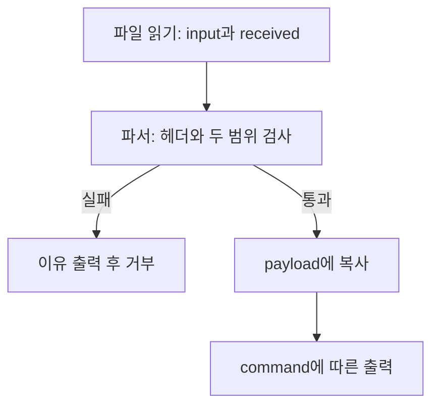

# Day130 — TPAR 입력 처리와 메모리 안전 조건 복습

- 계획: W01 기초 진단
- 기록일: 2026-10-08
- 범위: 기존 TPAR 결과 설명, 정상 입력 관찰, C 크기·수명 개념과 확인 방법
- 실제 학습 시간: 미측정

## 1. 입력·처리·출력 흐름

하네스는 입력 파일을 열고 내용을 지역 배열 input에 읽는다. read의 반환값 received에는 이번 호출에서 실제로 읽은 바이트 수가 저장된다. 읽기 오류를 검사한 뒤 input의 시작 주소와 실제 길이를 파서에 전달한다. 배열 용량은 입력을 담을 수 있는 공간의 크기이며 실제 입력 길이와 다르다.

파서는 TPAR 매직, version, command, length와 payload를 처리한다. 헤더는 7바이트다. 헤더의 length는 복사할 바이트 수를 나타내는 입력값이므로 실제로 그만큼의 데이터가 들어왔는지 별도 검사가 필요하다.

command 1에서는 payload를 지정한 길이만큼 fwrite로 출력한다. memcpy는 메모리 복사, fwrite는 스트림 출력이라는 역할 차이를 구분한다.

## 2. 기존 문제와 수정 원리

기존 사례는 복사 목적지 payload 배열의 용량 검사 누락으로 범위 밖 쓰기가 발생할 수 있었던 문제다. 입력 쪽 길이 검사는 이미 있었으므로 모든 length 검사가 없었다고 표현하면 부정확하다.

| 검사 | 확인하는 것 |
|---|---|
| input_size >= 7 | 헤더를 읽을 만큼 실제 입력이 있는가 |
| length <= input_size - 7 | 헤더 뒤에 복사할 데이터가 충분한가 |
| length <= sizeof(payload) | 복사받는 배열의 용량이 충분한가 |

헤더 최소 크기를 먼저 확인한 뒤 나머지 길이를 계산해야 한다. 입력 쪽 검사 통과만으로 목적지 공간의 안전성이 보장되지는 않는다. 수정 코드는 복사 전에 목적지 용량도 확인하여 초과 길이를 거부하도록 한다. sizeof(payload)로 전체 용량을 얻을 수 있는 것은 여기서 payload가 배열이기 때문이다.

## 3. 정상 입력에서 관찰한 결과와 한계

앞선 2026-10-07 확인에서는 Day115 파일 하네스와 Day119 수정 파서를 교사 실행 환경에서 일반 C 빌드로 실행했다. 두 입력 모두 유효한 헤더, command 1, length 4였으며 전체 입력 길이는 11바이트였다.

| Payload 바이트 | 실제 payload 출력 바이트(16진수) | 종료 코드 | stderr |
|---|---|---:|---|
| A B C D | 41 42 43 44 | 0 | 없음 |
| A / 널 / B C | 41 00 42 43 | 0 | 없음 |

두 실행 모두 payload 뒤에 줄바꿈과 state=6 출력이 있었다. 위 표의 4바이트는 payload 부분이며 전체 stdout 길이가 4바이트라는 뜻은 아니다.

중간의 널바이트가 있어도 지정한 바이트 수만큼 출력됐다. strlen은 첫 널바이트에서 길이 계산을 멈추므로 바이너리 입력의 실제 길이를 대신할 수 없다.

이번 두 정상 입력에서는 목적지 용량 초과 거부 분기를 실행하지 않았다. 따라서 이번 관찰은 두 입력의 정상 출력과 널바이트 처리에 대한 근거이며, 거부 분기 실행이나 모든 입력의 안전성을 증명하지 않는다. 코드에 검사가 있다는 사실과 그 분기가 실제 실행됐다는 사실을 구분해야 한다.

이는 이번 정상 입력 확인의 한계다. 이전 Day119~120 기록의 검증까지 수행되지 않았다고 일반화하지 않는다. 이번 학습에서 새 crash나 sanitizer 결과를 만들지는 않았다.

## 4. sizeof와 객체 수명

2026-10-08 정상 C 프로그램에서 char buffer[16]과 이를 가리키는 char *payload를 만들고 크기를 출력했다. C11, Wall/Wextra/Werror 조건에서 빌드 및 실행은 성공했다.

| 표현 | 실제 관찰값 | 의미 |
|---|---:|---|
| sizeof(buffer) | 16 | 배열 전체 크기 |
| sizeof(payload) | 8 | 포인터 변수 자체의 크기 |
| sizeof(*payload) | 1 | char 원소 하나의 크기 |

포인터 8바이트는 확인한 환경의 값이다. 포인터가 가리키는 배열의 용량을 나타내지 않는다. 배열을 32바이트로 바꾸면 배열 크기만 달라지고 포인터·원소 크기는 그대로라는 것은 사용자의 조건 변경 예측이며 별도 실행 결과는 아니다.

포인터로 복사 목적지를 전달하면 쓸 수 있는 전체 용량을 별도 인자로 전달해야 한다. 입력 쪽에는 실제 데이터 길이, 목적지 쪽에는 쓸 수 있는 공간의 용량이 필요하다.

지역 배열의 수명은 선언된 블록을 벗어날 때 끝난다. 함수 내부 블록의 배열은 함수 전체보다 먼저 수명이 끝날 수 있다. 지역 배열의 주소를 반환해도 수명이 연장되지 않는다. 호출자가 만든 버퍼를 함수가 채우는 방식에서는 호출자의 해당 블록이 살아 있는 동안 결과를 사용할 수 있다.

파일 디스크립터를 close하는 것은 이미 읽은 지역 배열의 수명을 끝내지 않는다. 반면 free된 메모리는 주소와 크기를 알고 있어도 접근할 수 없다.

## 5. 보안 전반 복습

- 입력을 실제로 처리하는 것은 타겟 프로그램이다. 타겟의 계측이 coverage를 기록하고 AFL++가 이를 읽어 새 계측 결과를 판단한다.
- 새로운 coverage 관찰은 오류 발생의 증명이 아니다. 같은 coverage라도 데이터와 접근 주소가 달라 오류 여부가 달라질 수 있다.
- 입력 형식 오류를 거부하고 return 1로 종료하는 것은 정상적인 오류 처리일 수 있다. 종료 코드만으로 crash라고 분류하지 않는다.
- 사용자는 타겟/AFL++ 역할과 새로운 분기/오류의 차이를 답했다. 마지막 종료 결과 질문에서는 원인을 확인해야 한다는 방향으로 답했고, 처음부터 crash로 가정하지 않는다는 점을 보충했다.
- 종료 이유를 확인할 때 stderr 메시지와 해당 메시지를 출력하는 코드 분기를 함께 확인한다.

## 6. 헷갈린 개념과 확인 방법 다섯 가지

| 개념 | 확인 방법 | 이번 상태 |
|---|---|---|
| 배열·포인터·원소의 sizeof | 타입으로 예상하고 작은 정상 프로그램의 출력과 비교 | 16/8/1 실제 관찰, 32/8/1은 예측 |
| 정상 거부와 종료 원인 | stderr와 실제 반환 분기를 연결 | 확인 방법 설명, 새 거부 실행 없음 |
| 지역 배열 수명 | 선언 블록의 끝과 사용 시점을 비교 | 내부 블록 예제로 설명 |
| 바이너리 입력 길이 | read의 성공 반환값을 기록하고 실제 읽힌 바이트와 비교 | 확인 방법 설명 |
| 코드상 기대와 실행 검증 | 조건 참/거짓 사례의 예상·관찰 결과와 분기 실행 근거를 각각 기록 | 방법 설명, 이번 정상 입력의 검증 한계 구분 |

각 방법을 설명한 것과 모두 새로 실행한 것은 구분한다.

## 7. 오늘 정리와 다음 학습

오늘 범위의 개념 문답과 복습 세 질문, 확인 방법 다섯 가지 정리는 마쳤다. 이미 답한 입력·처리·출력 흐름은 이 문서로 정리하며 같은 질문을 반복하지 않는다. 실제 시간이나 5분 독립 발표를 수행했다고 기록하지 않는다.

대표 설명 후보는 TPAR와 TinyXML-2다. TPAR의 역할·원인·수정·결과·한계를 사용자가 한 문단으로 연결했고, TinyXML-2와의 차이 비교는 다음 학습으로 넘긴다. W01 전체 도달 기준의 완료 여부는 별도로 확인한다.
