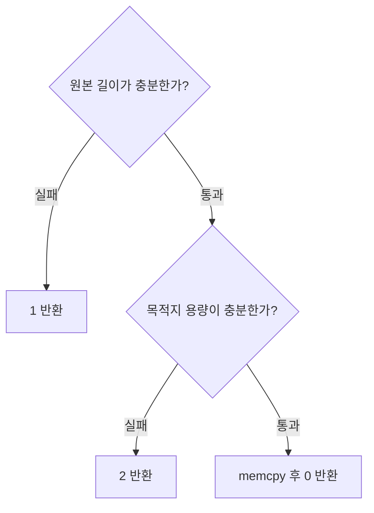
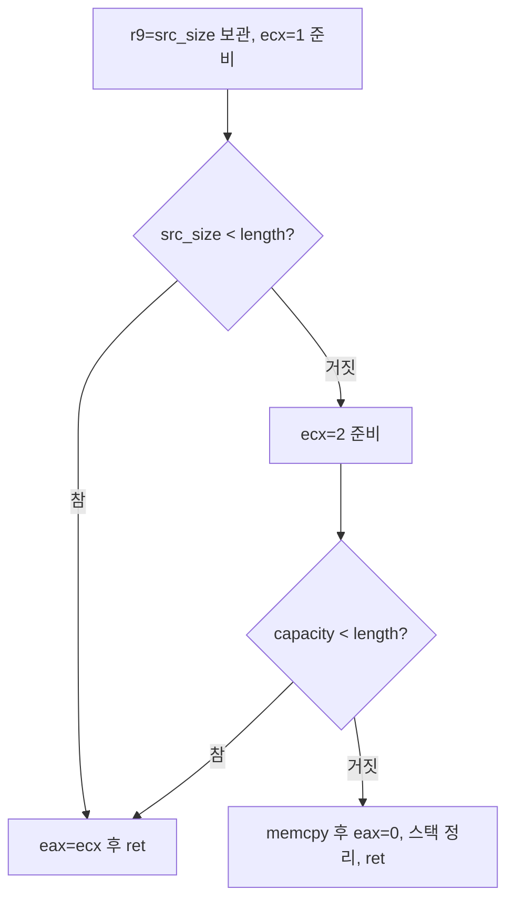

# Day139 — 소스와 분기 흐름 연결, callee-saved와 push/pop

- 학습일: 2026-10-22
- 계획: W03 바이너리 기초 / 3주차 3/5
- 수행: 기존 실제 역어셈블 읽기, 흐름 그림 공동 구성, 레지스터·스택 손 추적
- 상태: 오늘 문답·그림 정리 종료. push/pop은 추가 설명 후 확인했으며 독립 숙달로 판정하지 않는다.
- 실제 학습 시간: 미측정
- 새 실행 실험·컴파일·GDB·레지스터 캡처: 없음

## 1. 메인: 명령 나열을 역할 단위로 묶기

대상은 [Day137 O2 역어셈블](../Day137/disassembly_O2.txt)의 copy_data다. 함수 진입 시 이 환경에서 rcx=src_size, r8=length, rsi=capacity다.

첫 블록:
```asm
mov r9, rcx
mov ecx, 1
cmp r9, r8
jb  reject
```

사용자는 두 값 비교와 조건에 따른 점프를 설명했으나 한마디의 역할 이름을 붙이기 어려워했다. 교사는 명령 동작 대신 검사 대상을 기준으로 “원본 길이 검사”라고 묶도록 도왔다.

두 번째 블록:
```asm
mov ecx, 2
cmp rsi, r8
jb  reject
```

사용자는 복사받는 배열이 충분한지 검사한다고 답했다. 역할 이름은 “목적지 용량 검사”다.

## 2. 소스와 최적화된 기계어를 연결한 그림

대응하는 소스:
```c
if (length > src_size) return 1;
if (length > capacity) return 2;
memcpy(dst, src, length);
return 0;
```

사용자는 원본 검사 통과 시 목적지 검사, 실패 시 1 반환을 연결했다. 목적지 검사 통과 시 복사, 실패 시 2 반환을 설명했다. 정상 경로의 마지막 반환값 0은 교사가 보충했다.

### 소스 수준


### 실제 O2 코드의 공유 종료 구조


공통 거부 블록은 실제 역어셈블의 0x1318에 있는 mov eax,ecx; ret이다. 주소는 이번 파일의 표시이며 런타임 고정 절대 주소로 일반화하지 않는다.

| 소스 역할 | Day137 O2 표시 위치 | 명령과 결과 |
|---|---|---|
| 원본 길이 검사 | 0x12e4–0x12ef | 원본 길이 r9 보관, ecx=1, cmp r9,r8, jb |
| 목적지 용량 검사 | 0x12f1–0x12f9 | ecx=2, cmp rsi,r8, jb |
| 복사와 정상 반환 | 0x12fb–0x1313 | 인자 준비, call memcpy, eax=0, 스택 정리, ret |
| 공통 거부 반환 | 0x1318–0x131a | eax=ecx, ret |

두 그림은 교사와 사용자의 문답으로 공동 구성했다. 사용자가 완전히 무힌트로 독립 작성했다고 기록하지 않는다. W03의 연결 그림 초안을 이 문서에 보존하며 주간 설명·검토는 남아 있다.

### 코드 수정과 분석 표현의 차이
“두 경로를 한 블록으로 합친다”는 질문에 사용자는 두 검사 중 하나라도 실패하면 모두 1로 반환하도록 코드를 수정하자는 뜻으로 이해했다. 이 수정은 거부 여부는 유지할 수 있지만 기존 목적지 오류 반환값 2를 바꾼다.

교사가 기존 기계어에서 이미 공유하는 반환 블록을 그림에도 한 번 표시하려는 것이라고 설명했다. 사용자는 원본 실패 경로 ecx=1, 목적지 실패 경로 ecx=2라고 답했다. 분석 과정에서는 기존 동작을 재설계하지 않고 정확히 복원해야 한다.

## 3. CS: callee-saved 보존 책임

Linux x86-64 System V 호출 규약에서 rbx는 callee-saved다. 함수가 rbx를 바꿔 쓰면 자기 호출자가 가진 원래 값을 반환 전에 복원해야 한다.

설명 예제:
| 시점 | rbx | 책임 |
|---|---:|---|
| 우리 함수 진입 | 100 | 호출자의 원래 값 |
| 우리 함수가 사용 | 200 | 원래 100은 별도 저장 필요 |
| memcpy 호출 후 | 200 | memcpy가 호출 시점의 rbx를 보존 |
| 우리 함수 반환 | 100 | 우리 함수가 자기 호출자의 값 복원 |

사용자는 처음 memcpy 이후 새 값을 넣는 상황으로 오해했다. 설명 후 반환 시 100으로 되돌리고, 덮어쓰기 전에 원래 값을 따로 저장한다고 답했다.

이것은 별도 학습 예제다. Day137 실제 copy_data에 rbx 저장 코드가 있다는 뜻은 아니다.

## 4. 복습: 모든 반환 경로의 복원과 fall-through

함수 진입에서 push rbx로 저장했다면, 그 저장을 거쳐 반환하는 경로는 올바른 복원·스택 정리를 거쳐야 한다. 각 경로마다 별도의 pop rbx가 필요한 것은 아니며 공통 블록을 사용할 수 있다.

```asm
normal:
    mov eax, 0
    jmp finish
reject:
    mov eax, 1
finish:
    pop rbx
    ret
```

사용자는 처음 두 경로가 모두 복원을 거치지 않을 것이라고 답했다. 라벨은 코드 위치의 이름일 뿐 실행 장벽이 아니며, 거부 경로는 다음 명령으로 이어져 pop rbx를 실행한다는 설명 후 잘못 생각했다고 답했다.

정상 경로는 jmp finish로, 거부 경로는 순차 실행(fall-through)으로 같은 복원 블록에 도달한다. 위 코드는 제어 흐름 설명 발췌로, 전체 함수·호출 시 스택 정렬까지 제공하는 실행 코드가 아니다.

### pop 없이 ret하는 변형
```asm
reject:
    mov eax, 1
    ret
finish:
    pop rbx
    ret
```

앞서 push rbx를 했고 다른 스택 변경이나 복원이 없다고 가정한다.

| ret 전 위치 | 내용 |
|---|---|
| [rsp] | 저장한 이전 rbx 값 |
| [rsp+8] | 실제 복귀 주소 |

이 상태에서 ret은 저장한 rbx 값을 복귀 주소처럼 rip에 넣으려 한다. 단순 레지스터 보존 실패뿐 아니라 스택 정리 누락으로 잘못된 실행 위치를 선택한다. 실제 종료 증상은 실행하지 않았으므로 확정하지 않는다.

사용자는 이 변형과 pop 뒤 rsp 위치에서 막혔다. 교사 설명 후 rsp=0x2000에서 pop rbx 직후 rsp=0x2008을 답했다. 이를 독립 숙달로 기록하지 않는다.

## 5. 종료 선언 후 추가 보완: rsp가 무엇을 가리키는가

교사가 일단 문답을 종료했지만 사용자가 이해가 부족하다며 질문을 이어갔다. 최종 기록은 그 추가 설명까지 포함한다.

핵심 교정:
- rsp는 rbx 레지스터 자체를 가리키지 않는다.
- push rbx로 rbx의 값을 복사해 저장한 메모리 칸의 주소를 담는다.
- 레지스터 값과 스택에 복사한 값은 별개다. 이후 rbx를 바꿔도 이미 저장한 값은 자동 변경되지 않는다.

가정: rbx=100, rsp=0x2008이고 [0x2008]에 복귀 주소가 있다.

| 동작 | rsp | 결과 |
|---|---|---|
| push rbx | 0x2000 | [0x2000]에 100 저장 |
| mov rbx,200 | 0x2000 | rbx만 200, 저장한 100 유지 |
| pop rbx | 0x2008 | [0x2000]의 100을 rbx로 복원 |
| 다음 ret | 0x2010 | [0x2008]의 복귀 주소로 이동 |

64비트 일반 레지스터 push/pop 기준이다. push는 rsp를 먼저 8 줄이고 저장하며, pop은 현재 [rsp] 값을 대상에 넣은 뒤 rsp를 8 늘린다. pop rsp 같은 특수 대상은 오늘 설명 범위가 아니다.

### LIFO 조건 변경
```asm
; rax=10, rbx=20
push rax
push rbx
pop rcx
```

사용자는 rcx=20을 맞히고 rsp가 스택 맨 위에서 push한 값의 칸을 가리키는지 질문했다. 교사는 레지스터 자체가 아니라 복사한 메모리 값을 가리킨다고 명확히 했다. 이 예제에서는 pop 후 다음 스택 꼭대기에 10이 남는다.

이 발췌는 push 하나가 아직 남아 있으므로 그대로 ret하면 안 된다. 예제를 실행 가능한 함수로 만들려면 남은 스택 저장도 정리해야 한다. 오늘은 실행하지 않았다.

## 6. 확인 수준·한계·다음 진도

- 메인: 원본·목적지 검사 역할을 이름 붙이고 소스와 공통 반환 구조의 흐름 그림을 공동 작성.
- CS: 호출자/호출받은 함수의 상대적 보존 책임을 설명받고 원래 값 저장·복원 방향을 확인.
- 복습: 공통 복원 경로, 라벨을 가로지르는 순차 실행, push/pop의 스택 이동을 교정.
- 추가 보완 후 rcx=20과 rsp가 복사된 값의 메모리 칸을 가리킨다는 원리를 연결했다. 실제 추적과 독립 설명으로의 재확인은 남겨 둔다.
- 새 실행·컴파일·GDB·레지스터 덤프·crash·sanitizer·실측 학습 시간은 없다.
- 순차 실행·push/pop이 약한 상태에서 종료를 먼저 선언한 교사의 판단은 수정하여, 도움받아 확인한 수준으로 기록한다.

다음: Day140 / 3주차 4/5 — 작은 실제 관찰로 push/pop·복원 경로와 흐름 그림을 대조한다. 실행 전 사용자가 예상과 확인할 값을 정하고, 환경의 디버거 가용성을 먼저 확인한다. CS는 스택 변화와 호출 시 정렬, 복습은 그림에 표시한 경로와 관찰 증거를 연결한다. 이미 맞힌 기본 길이 검사를 반복해 분량을 채우지 않는다.
