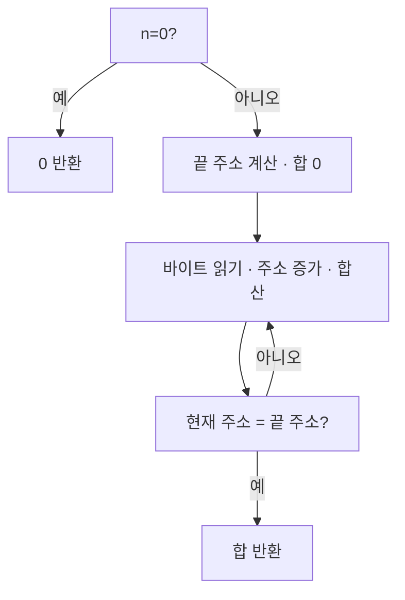

# Day141 — 반복문과 최적화된 주소 비교

- 학습일: 2026-10-23 (Asia/Seoul), Day140 후 추가 회차.
- 계획: W03 바이너리 기초 / 5/5.
- 메인·CS·복습 시간 미측정. 두 회차를 실측 6시간으로 기록하지 않는다.

## 소스와 조건

```c
unsigned int sum_bytes(const unsigned char *data, size_t n) {
    unsigned int sum = 0;
    for (size_t i = 0; i < n; ++i) sum += data[i];
    return sum;
}
```

n은 읽을 바이트 수이며 유효한 입력 범위 안이어야 한다. i<n은 n 자체가 실제 배열 크기 이하임을 보장하지 않는다. 크기3 배열에 n4를 넘기면 data[3] 접근을 막지 못한다고 답했다. 이 잘못된 입력의 실행은 하지 않았다.

본문 전 조건 검사와 뒤쪽 반복 분기를 구분했다. 설명용 cmp i,n 다음 jae 종료는 i>=n, ja 종료는 i>n이어서 후자는 i==n에도 읽는 off-by-one을 만든다. ja 의미는 설명을 받았다. 뒤쪽 비교만 남기면 n0에서도 첫 data[0]을 이미 읽고 i1이 되므로 앞쪽 0 검사가 필요함을 힌트 후 설명했다.

## 실제 빌드와 실행

sum_bytes.c와 sum_bytes_test.c를 별도 소스 파일로 빌드했고 LTO는 사용하지 않았다. 각 최적화 버전에서 함수의 역어셈블도 저장했다.

```bash
cc -std=c11 -Wall -Wextra -Werror -O0 -g sum_bytes.c sum_bytes_test.c -o sum_bytes_O0
cc -std=c11 -Wall -Wextra -Werror -O2 -g sum_bytes.c sum_bytes_test.c -o sum_bytes_O2
./sum_bytes_O0
./sum_bytes_O2
objdump -d -Mintel --disassemble=sum_bytes sum_bytes_O0
objdump -d -Mintel --disassemble=sum_bytes sum_bytes_O2
```

입력은 {1,0,3}. 두 빌드와 두 실행은 exit0이었다.

| n | 예상 반환 | O0 | O2 |
|---:|---:|---:|---:|
| 0 | 0 | 0 PASS | 0 PASS |
| 1 | 1 | 1 PASS | 1 PASS |
| 3 | 4 | 4 PASS | 4 PASS |

사용자는 원소0은 주소 기반 반복 조건에 영향을 주지 않으며 합4라고 예상했다. 세 입력의 반환값 일치는 모든 유효 입력의 동등성 증명이 아니라고 구분했다. 반환값을 측정했으며 읽기 횟수·일시적 접근을 계측하지 않았다.

## 실제 O2 대응

처음 수업에서 분리 오브젝트의 함수 상대 주소 0x00~0x22를 읽었다. 보존한 disassembly_O2.txt는 최종 실행 파일의 주소 0x1270~0x1292다. 서로 다른 주소 표현을 혼동하지 않는다.

| 소스 역할 | 최종 O2 명령 |
|---|---|
| n0이면 본문 건너뛰기 | 0x1274 test rsi,rsi / 0x1277 je 0x1290 |
| 끝 주소 계산 | 0x1279 add rsi,rdi |
| sum0 | 0x127c xor eax,eax |
| 현재 바이트 읽기 | 0x1280 movzx edx,BYTE PTR [rdi] |
| 다음 주소 | 0x1283 add rdi,1 |
| sum에 더하기 | 0x1287 add eax,edx |
| 끝 주소 도달 검사 | 0x1289 cmp rdi,rsi / 0x128c jne 0x1280 |
| 정상 반환 | 0x128e ret |
| 빈 입력 반환 | 0x1290 xor eax,eax / 0x1292 ret |

진입 시 rdi=data, rsi=n이지만 add 후 rsi는 끝 주소다. 이후 rdi는 이동하는 읽기 주소, edx는 읽은 값, eax는 합이다. [rdi]는 주소 자체가 아닌 그 위치의 메모리를 읽는다.

data 시작0x1000/n3이면 끝0x1003은 data[2] 다음이다. 크기3 배열의 끝 다음 주소는 계산·비교할 수 있지만 역참조하면 안 된다. 더 큰 배열이라면 그 위치에 값이 있을 수 있으며 n3이라는 합산 범위에서만 제외된다. 사용자의 “값은 없다” 표현을 교정했다.

O0에는 스택의 i/n 비교와 본문 전 검사로 향하는 초기 jmp가 있다. O2에는 n0 사전 분기와 주소 증가/끝 주소 비교가 있다. O0 전체는 교사가 자료로 추출했으며 사용자와 명령별로 모두 분석한 것은 아니다. O2 경로는 대화에서 함께 추적했다.



## CS — 보존 책임과 복원 시점

rdi/rsi가 초기화하지 않으면 남을 것이라는 답을, System V AMD64 caller-saved여서 호출 뒤 보존을 가정할 수 없다는 설명으로 교정했다. 호출 이후 원래 data가 필요하면 보존되는 레지스터에 저장하겠다고 답했다. rbx를 사용한다면 우리 함수도 들어올 때의 rbx를 보존해야 한다.

```asm
push rbx
mov rbx, rdi
call sum_bytes
movzx edx, BYTE PTR [rbx]  ; data가 적어도 1바이트 유효할 때만
pop rbx
ret
```

위는 설명용 발췌이며 컴파일·실행하지 않았다. n0에도 무조건 첫 바이트를 읽어도 된다는 일반 예제가 아니다. 처음 교사가 실제 사용 명령 없이 주석만 놓아 복원 순서 질문이 모호했고 사용자가 지적해 movzx를 추가했다.

기존 rbx100을 push한 후 rbx를 0x1000으로 바꾸어도 스택에는100이 남는다. 사용자는 pop 후0x1000이라 답했다가 설명 후 “스택의100을 다시 넣는다”라고 스스로 교정했다. 호출→보관한 주소 사용→pop 복원의 순서를 맞혔다. movzx가 rbx를 수정하지 않더라도 앞선 pop이 주소를 바꾼다는 것이 핵심이다.

## 주간 설명과 남은 점

최종 설명에서 n0이면 본문0회/반환0, n>0이면 읽기→주소 증가→끝 주소 비교→동일 시 종료/다르면 반복을 말했다. n0 검사 존재를 다시 물었고 교사가 test/je를 재제시했으며 합산 단계를 보충했다. 완전 무힌트 종합 발표로 기록하지 않는다.

Day139의 조건·반환 그림과 오늘 반복문 그림으로 W03 함수·분기·루프 연결 범위를 정리했다. 도움을 받아 이해한 부분을 주간 독립 숙달로 바꾸어 기록하지 않는다. 관찰은 이번 반환값과 Day140 계측 값, 경로 설명은 정적 읽기/손 추적이다. GDB·sanitizer·crash·퍼징·속도 측정은 없다.

다음: Day142 / W04 실행 환경 / 1/5. 실행 파일·라이브러리·로더 큰 흐름부터 시작하고 ELF 섹션/세그먼트를 연결한다. call/ret 방향, caller/callee-saved, 복원 시점은 짧은 약점 복습으로 유지한다. 기존 메모리 오류·ASan 보고서는 W04에 연결한다. 실측 5분 독립 설명과 다중 분기 공통 복원 경로의 동적 관찰은 미확인이다.
